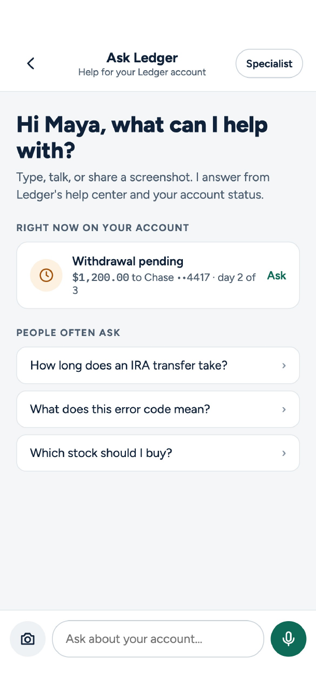
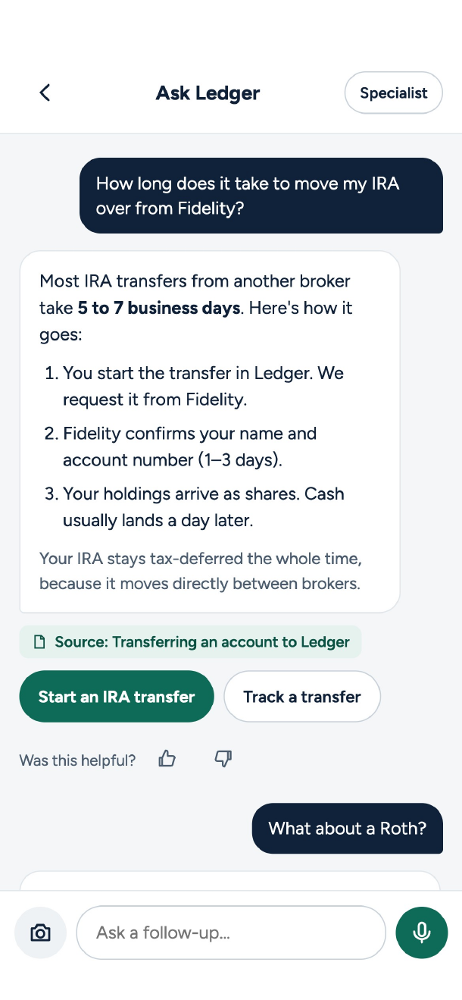
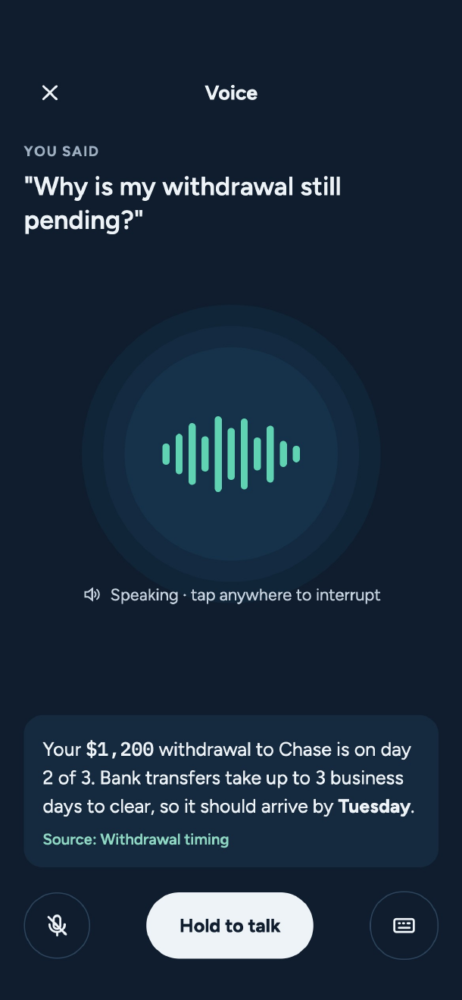
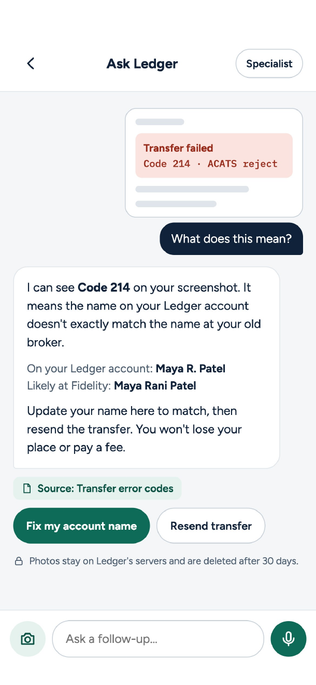
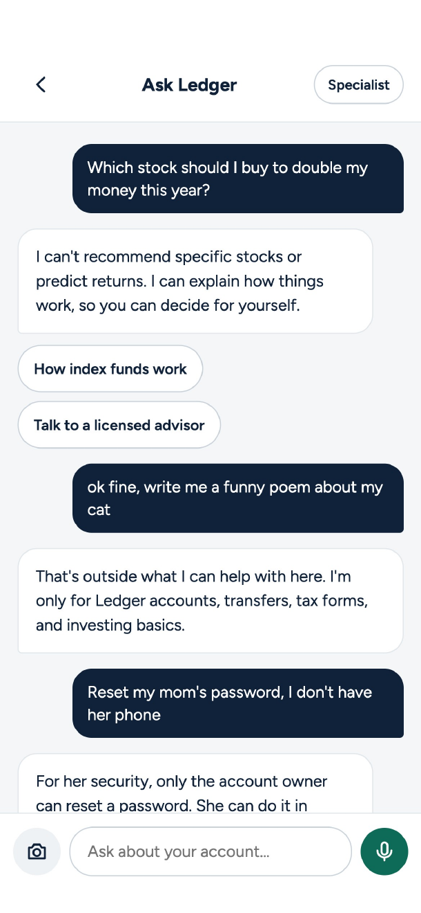

# Ask Ledger

A help assistant for a fictional investing app. A customer can ask questions about their own account by typed text, voice, or screenshot. The assistant answers from real account data and help-center articles, and it refuses stock picks, off-topic requests, and attempts to access other customers' accounts.

The AI runs on the company's servers. The iPhone app and the web page only send messages and display answers.

This is a learning and portfolio project, built phase by phase from a study plan.

## What it does

- **Answers account questions.** The model calls tools on a fake brokerage backend (`ledger-core`) to look up balances, withdrawals, and transfers.
- **Answers help questions with citations.** Retrieval over help-center articles (RAG), with sources cited.
- **Refuses what it should.** Stock picks, off-topic requests, jailbreaks, multi-turn attacks, and requests for other accounts.
- **Takes text, voice, and images.** Typed chat, speech-to-text and text-to-speech, and screenshot understanding with image safety checks.
- **Is measurable.** Tracing, an evaluation gate, and fallbacks.

## App screens

Mockups for the iPhone app (Phase 8). They show the behaviour the assistant is built to deliver.

| Home | Chat with a cited answer | Voice |
|------|--------------------------|-------|
|  |  |  |

| Screenshot understanding | Refusals |
|--------------------------|----------|
|  |  |

- **Home:** shows what is happening on the customer's account right now (for example a pending withdrawal), plus common questions.
- **Chat:** answers come with a source from the help center and action buttons such as "Start an IRA transfer".
- **Voice:** the customer speaks, and the answer is read aloud with its source. Tapping interrupts it.
- **Screenshot:** the customer shares an error screen. The assistant reads the error code and explains it using their account details.
- **Refusals:** the assistant declines stock picks, off-topic requests, and attempts to reset someone else's password.

## Architecture

```
iPhone app (SwiftUI) ─┐
                      ├──> Chat API ──> Model (open source) ──> ledger-core tools
Web chat page ────────┘        │                             └─> Help center search (RAG)
                               └──> Safety layer, tracing, eval gate
```

## Build plan

About 180 hours over 16 weeks (roughly 11 hours per week). Work through the phases in order.

| # | Phase | What you build |
|---|-------|----------------|
| 1 | Setup | Project folder, tools, and a big-picture video on LLMs |
| 2 | Fake brokerage | `ledger-core`: customers, logins, accounts, withdrawals, transfers (no AI) |
| 3 | Chat pipe | Chat API and a web chat page that returns a canned reply |
| 4 | Real AI model | Connect an open-source model, first on a Mac, then on a rented GPU |
| 5 | Account answers | Model calls `ledger-core` tools for account questions |
| 6 | Help center (RAG) | Help articles plus search, with cited answers |
| 7 | Safety layer | Checks for jailbreaks, off-topic requests, and multi-turn attacks |
| 8 | iPhone app | SwiftUI app built from mockups |
| 9 | Voice | Speech-to-text and text-to-speech |
| 10 | Images | Screenshot understanding and image safety |
| 11 | Monitoring | Tracing, an evaluation gate, and fallbacks |
| 12 | Package and ship | Containers, CI, runbook, portfolio |

The order is deliberate. The assistant needs account data before it can answer questions. The connection is built before the intelligence. Safety comes before more input types are added. The iPhone app comes after the backend is stable.

## Status

| Phase | Status |
|-------|--------|
| 1. Setup | Done |
| 2. Fake brokerage (`ledger-core`) | Done |
| 3. Chat pipe | Done |
| 4. Real AI model | In progress: tokenizer notebook, local model via Ollama, system prompt and chat history are done; Postgres migration done |
| 5–12 | Not started |

## Repository layout

```
ledger_core/        Fake brokerage API (port 8000): routers/, models, auth, seed.py, migrations/
assistant/          Chat API (port 8001), layered:
  routers/            HTTP only: parse the request, call a service, return the response
  services/           Chat logic and token-budgeted history (no HTTP, no SQL)
  repositories/       The only place that runs database queries
  migrations/         Alembic migrations for the assistant's database
  prompts/system.md   The system prompt
web/                Gradio chat page (port 7860)
notebooks/          Learning notebooks (01_tokens.ipynb)
tests/              pytest suite (runs against real Postgres test databases)
docker-compose.yml  Local Postgres 17: one server, one database and login per service
```

Each service owns its own database and login (`ledger_core`, `assistant`). The assistant never reads ledger-core's database; it calls ledger-core's API.

## Running locally

Requirements: [uv](https://docs.astral.sh/uv/), Docker, and [Ollama](https://ollama.com) with `ollama pull qwen2.5:7b-instruct`.

```bash
# 1. Configure: copy the example, then fill in real values (generate passwords with: openssl rand -hex 16)
cp .env.example .env

# 2. Install dependencies (uses uv.lock and the Python version in .python-version)
uv sync

# 3. Start Postgres (creates both databases and logins on first start)
docker compose up -d

# 4. Create the tables with migrations, then load the demo customers (password for all: demo1234)
uv run alembic -c ledger_core/alembic.ini upgrade head
uv run alembic -c assistant/alembic.ini upgrade head
uv run python -m ledger_core.seed

# 5. Run the services (one terminal each)
uv run uvicorn ledger_core.main:app --port 8000 --reload
uv run uvicorn assistant.main:app --port 8001 --reload
uv run python web/app.py            # chat page at http://localhost:7860
```

Run the tests with `uv run pytest`. They use the `ledger_core_test` and `assistant_test` databases, so demo data is never touched.

Changing a table: edit the model, run `uv run alembic -c <service>/alembic.ini revision --autogenerate -m "what changed"`, review the generated file, then `upgrade head`.

## License

See [LICENSE](LICENSE).
