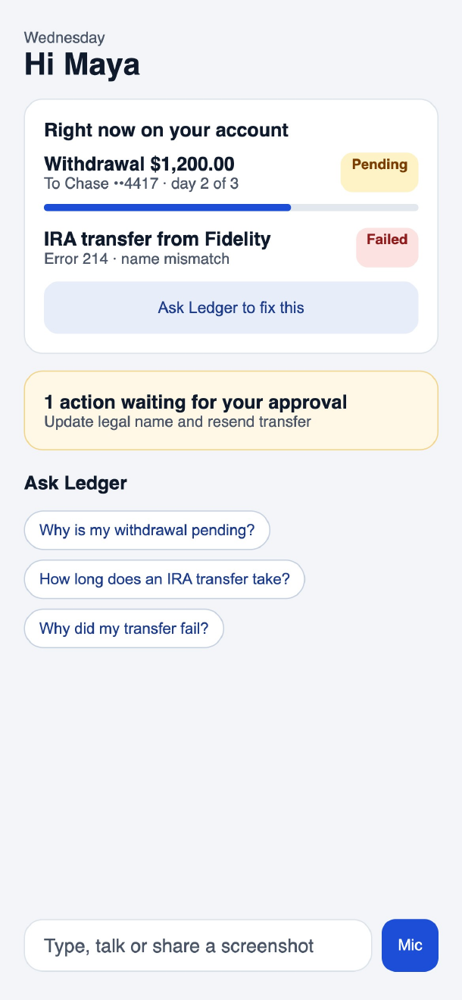
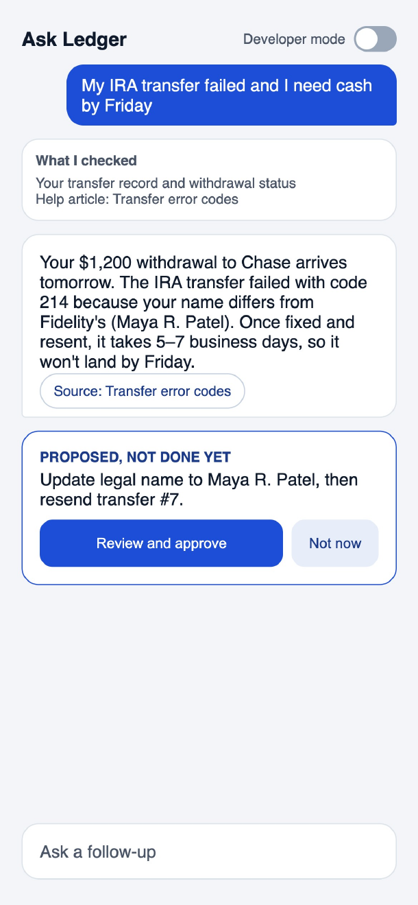
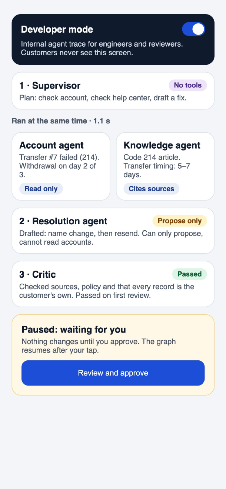
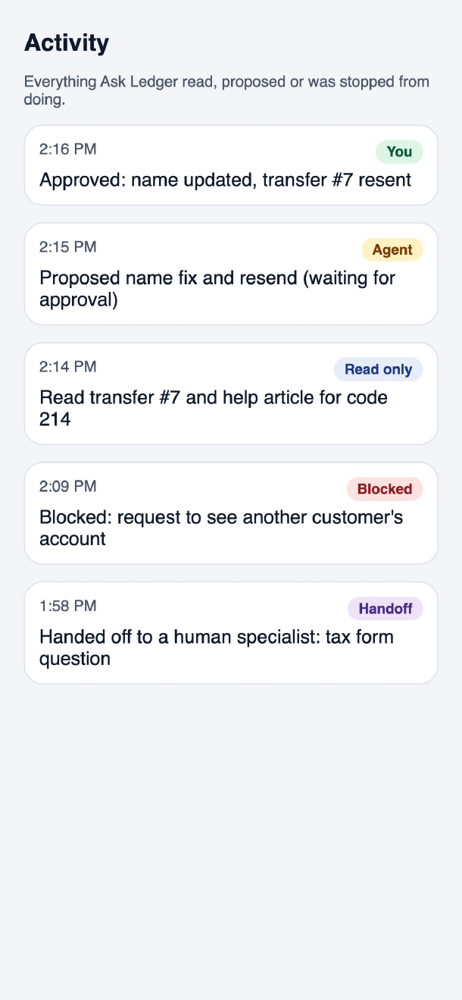
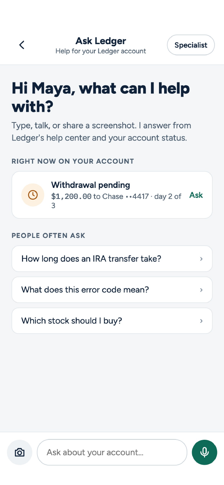
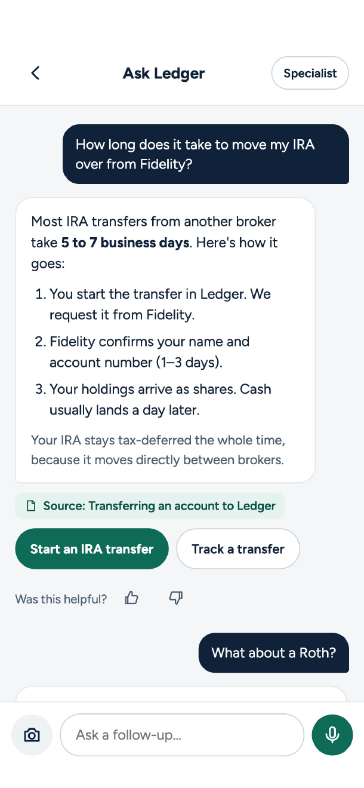
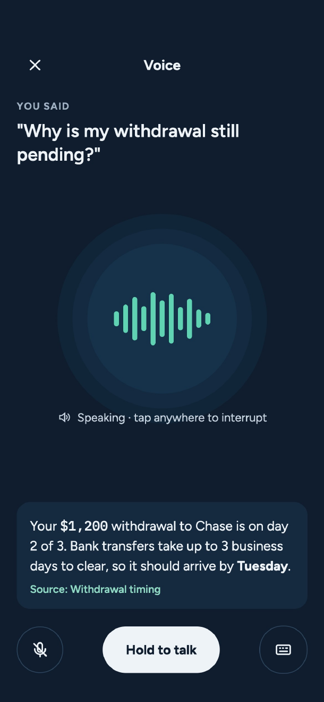
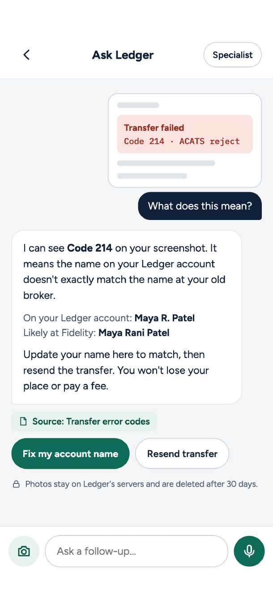
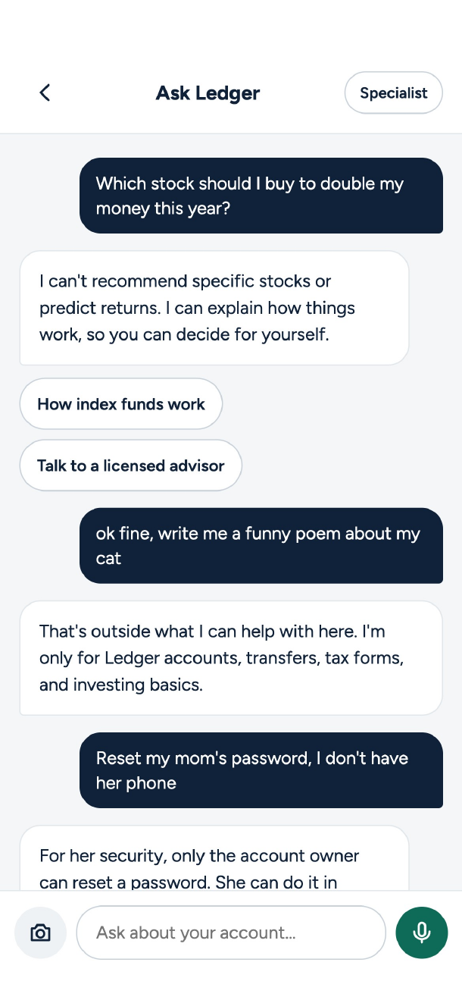

# Ask Ledger

A help assistant for a fictional investing app. A team of AI agents answers questions about the customer's own account, proposes fixes, and waits for the customer's approval before anything changes. The assistant answers from real account data and help-center articles, and it refuses stock picks, off-topic requests, and attempts to access other customers' accounts.

The AI runs on the company's servers. The iPhone app and the web page only send messages and display answers.

This is a learning and portfolio project, built phase by phase from a study plan. The sections below describe the target design; the [Status](#status) table says what is built today.

## What it does

- **Answers account questions.** The model calls tools on a fake brokerage backend (`ledger-core`) to look up balances, withdrawals, and transfers.
- **Answers help questions with citations.** Retrieval over help-center articles (RAG), with sources cited.
- **Proposes fixes and waits for approval.** Some tools can only *propose* a change (retry a transfer, update a legal name). Nothing runs until the customer approves, and every step is written to an audit log.
- **Works as a team of agents.** A supervisor plans; an account agent (read only) and a knowledge agent (cites sources) work at the same time; a resolution agent can only propose; a critic checks the answer before the customer sees it.
- **Refuses what it should.** Stock picks, off-topic requests, jailbreaks, multi-turn attacks, and requests for other accounts.
- **Is measurable.** Tracing, an evaluation gate, and fallbacks.

Example: *"My IRA transfer failed and I need cash by Friday."* The account agent and the help-center agent work in parallel. The answer says the $1,200 withdrawal arrives tomorrow and a fixed transfer takes 5 to 7 business days, so it won't land by Friday. A proposed fix (update the legal name, resend the transfer) waits for the customer to approve with Face ID, and every step shows in an Activity log.

## App screens

Mockups for the iPhone app (Phase 8). They show the behaviour the assistant is built to deliver. **None of the proposal, approval or agent screens is built yet.** The server side of approvals exists (proposals, approve and reject, the audit log, and an `approval_required` event in the chat stream), but there is no app screen for it yet (see [Status](#status)).

| Home | Chat with a proposed action | Developer mode |
|------|-----------------------------|----------------|
|  |  |  |

| Approval | Activity |
|----------|----------|
|  |  |

- **Home:** shows what is happening on the customer's account right now, an "action waiting for your approval" banner, and common questions. Built in steps 8.2 and 8.3, on top of the approval flow (5.4).
- **Chat:** shows "What I checked" (from the tool and source events), then a sourced answer, then a clearly labelled **proposed, not done yet** action with "Review and approve" and "Not now". Customers never see agent names.
- **Developer mode:** an internal trace for engineers and reviewers, off by default. It shows the supervisor's plan, the account and knowledge agents running in parallel, the resolution agent (propose only), and the critic's verdict, then the pause for approval. Built with the multi-agent phase (7B) and step 8.3. Customers never see this screen.
- **Approval:** lists each change in plain words. The customer's tap, confirmed with Face ID, is what runs it. The assistant cannot do it alone. Built in steps 5.4 and 8.3.
- **Activity:** the audit log of everything read, proposed, blocked or handed to a human, with who did it and when. Backed by the `audit_log` table and `GET /activity` (5.4).

### Earlier mockups (v1)

The first design also showed voice, screenshot understanding and refusals. Voice and image input are now optional stretch steps; refusals remain part of the safety layer (Phase 7).

| Home | Chat with a cited answer | Voice |
|------|--------------------------|-------|
|  |  |  |

| Screenshot understanding | Refusals |
|--------------------------|----------|
|  |  |

## Architecture

Target design. Today the single agent loop in `assistant/services/agent.py` plays the role of the account agent, with read-only tools.

```
iPhone app (SwiftUI) ─┐
                      ├──> Chat API ──> Supervisor ─┬─> Account agent ────> ledger-core (read-only tools)
Web chat page ────────┘        │                    ├─> Knowledge agent ──> Help center search (RAG)
                               │                    └─> Resolution agent ─> proposed actions (propose only)
                               │                              │
                               │                           Critic ──> customer approves ──> ledger-core
                               └──> Safety layer, audit log, tracing, eval gate
```

## Build plan

About 190 hours over 17 weeks (roughly 11 hours per week). Work through the phases in order.

| # | Phase | What you build |
|---|-------|----------------|
| 1 | Setup | Project folder, tools, and a big-picture video on LLMs |
| 2 | Fake brokerage | `ledger-core`: customers, logins, accounts, withdrawals, transfers (no AI) |
| 3 | Chat pipe | Chat API and a web chat page that returns a canned reply |
| 4 | Real AI model | Open-source model on a Mac with Ollama, a system prompt and conversation memory |
| 5 | Account answers | 14 tools (read, help-center search and propose-only) plus an approval flow with an audit log |
| 6 | Help center (RAG) | Help articles plus search, with cited answers |
| 7 | Safety layer | Checks for jailbreaks, off-topic requests, and multi-turn attacks |
| 7B | Multi-agent orchestration | Supervisor and specialist agents in LangGraph, parallel work, a critic, a durable pause for approval, and a single-agent vs multi-agent comparison |
| 8 | iPhone app | SwiftUI app: chat, approval sheet, Activity screen and a hidden Developer mode |
| 11 | Monitoring | Tracing (one span per agent), an evaluation gate, and fallbacks |
| 12 | Package and ship | Docker Compose, CI, runbook, one cloud deployment, portfolio |

Optional stretch steps: vLLM, voice and image understanding.

The order is deliberate. The assistant needs account data before it can answer questions. The connection is built before the intelligence. Safety comes before more input types are added, and before the agent team, because every request, tool result and proposed action must pass the same guards. The iPhone app comes after the backend is stable.

## Status

| Phase | Status |
|-------|--------|
| 1. Setup | Done |
| 2. Fake brokerage (`ledger-core`) | Done |
| 3. Chat pipe | Done |
| 4. Real AI model | Done: tokenizer notebook, local model via Ollama, system prompt, token-budgeted chat history, Postgres |
| 5. Account answers | Done: all 14 tools (10 read-only, including a withdrawal-eligibility check whose rules live in ledger-core and the help-center search; three propose-only: retry a failed transfer, cancel a pending withdrawal, update the legal name; and a human hand-off that logs the request with a reference number), an agent loop, saved lookups for follow-up questions, tool-choice evals, and the approval flow behind it (proposals, approve and reject with 24 hour expiry and double-tap protection, an append-only audit log, and `GET /actions`, `POST /actions/{id}/approve`, `POST /actions/{id}/reject`, `GET /activity`) |
| 6. Help center (RAG) | In progress: six articles split by heading into passages, embedded with `nomic-embed-text` and stored in Postgres with pgvector; fingerprinted indexing that only re-embeds changed passages; a measured relevance cut-off; the search runs in code whenever the router says a message is a how-things-work question; retrieval and answer-quality evals; a `sources` event naming the article(s) a help answer came from; a passage judge (one short model call that keeps only the nearby passages that really answer the question); a keyword-search column and query (Postgres full-text) ready for hybrid ranking. Still to do: merge keyword and vector rankings (reciprocal rank fusion), if the retrieval eval shows it helps |
| 7, 7B, 8, 11, 12 | Not started |

## Repository layout

```
ledger_core/        Fake brokerage API (port 8000): routers/, models, auth, seed.py, migrations/
assistant/          Chat API (port 8001), layered:
  routers/            HTTP only: parse the request, call a service, return the response
  services/           Chat logic, the agent loop (agent.py) and token-budgeted history (no HTTP, no SQL)
  repositories/       The only place that runs database queries
  clients/            Calls to ledger-core (with the caller's own token) and to the embedding model
  tools/              What the model may ask for: one module per purpose (accounts, withdrawals, transfers, fees, tax_documents,
                      error_codes, arrival_estimates), each with its arguments, code and menu entry; __init__.py lists them all;
                      registry.py validates and runs them
  knowledge/          Facts kept in code (the transfer error-code catalog, business-day date math) and the help-center articles
                      (help_center/*.md) with the code that splits them into passages by heading
  migrations/         Alembic migrations for the assistant's database
  prompts/            The system prompt and the router prompt
evals/              Exams (JSONL cases) and their runners: tool choice, help-center retrieval, answer quality; reports are gitignored
web/                Gradio chat page (port 7860)
notebooks/          Learning notebooks (01_tokens.ipynb)
tests/              pytest suite (runs against real Postgres test databases)
docker-compose.yml  Local Postgres 17 with the pgvector extension: one server, one database and login per service
```

Each service owns its own database and login (`ledger_core`, `assistant`). The assistant never reads ledger-core's database; it calls ledger-core's API.

## How an account question is answered

The model never touches the data. It can only *ask* for a lookup; our code runs it.

1. The router identifies the customer from their token and hands over to `ChatService`.
2. `ChatService` saves the message and builds the prompt: the system rules plus recent history, trimmed to a token budget. Lookups from the last two assistant replies are replayed, labelled as snapshots that may be out of date.
3. A short routing question to the same model (`assistant/services/tool_router.py`) picks which kinds of help the message needs (`account`, `reference`, `help`, `change`, `human` or `none`), using the last few messages so short follow-ups such as "cancel it" make sense. The model is then offered only those tools (3 to 6 instead of all of them), and only those can run. If routing fails, every tool is offered.
4. If the route is `help` (a question about how things work, such as "what is a Roth IRA?"), our code runs the help-center search itself before the model speaks, so a small model cannot skip it and invent an answer. The question is embedded, the closest passages are found in Postgres (pgvector), anything farther than the cut-off is dropped, a short model call (the passage judge, `assistant/services/passage_judge.py`) keeps only the passages that directly answer the question, and the rest reach the model as a labelled tool result. If the judge fails or replies with nonsense, every nearby passage is kept, so a broken judge never breaks an answer. If nothing is close enough, the model is told to say it does not have that information.
5. The agent loop (`assistant/services/agent.py`) asks the model, offering that menu. If the model asks for tools, the registry validates the arguments, runs the calls in parallel with a 2 second limit, and returns the results labelled as data. This repeats for up to 3 rounds and 6 calls, then the model must answer.
6. The answer streams to the client as server-sent events (`token`, `tool`, `approval_required`, `sources`, `done`, `error`) and is saved with its lookups. `sources` carries the names of the help-center articles the search returned (each once), and is sent only when a search found something, so the app can show "Source: ..." under the answer. In the code, `ChatService.stream_reply` only orchestrates: the tools drop what needs announcing into a `PendingAnnouncements` object (proposals, article names), and `_announcements_after_round` turns it into events after each round.

Safety by design: no tool takes a customer id (the caller's token decides whose data it is), unknown arguments are rejected, and text inside results is never treated as instructions. Most tools only read. The three propose tools can only save a proposal; nothing changes until the customer approves it with their own request (`POST /actions/{id}/approve`).

Tools: `get_accounts`, `get_withdrawals`, `get_transfers`, `get_transfer_status`, `get_fees` and `get_tax_documents` (these six call ledger-core), `lookup_error_code` and `estimate_arrival` (pure code, so the model never does date arithmetic), `check_withdrawal_eligibility`, `escalate_to_human` and `search_help_center` (the last one is run by our code on the `help` route). To add a tool, write its module in `assistant/tools/` and add it to `ALL_TOOLS` in `assistant/tools/__init__.py`.

## Evals

`evals/` measures which tools the model chooses and with what arguments. It asks the real model each question and scores the tool requests; no tools are run.

```bash
uv run python -m evals.run_tool_eval                                        # main set
uv run python -m evals.run_tool_eval --dataset evals/tools_hard.jsonl --runs 2
uv run python -m evals.run_tool_eval --dataset evals/tools_multiturn.jsonl  # follow-up questions with history
uv run python -m evals.run_tool_eval --dataset evals/tools_propose.jsonl     # propose-only tools (approval flow)
uv run python -m evals.run_tool_eval --no-router                           # offer every tool, as before routing existed
```

- `--runs N` asks each question N times; a question that passes only some of the time is labelled FLAKY. `--min-score` sets the pass mark (exit code 1 below it, for CI).
- A case has one main answer (`expected_tools`) and may list `alternatives`: other answers that are just as correct (for example looking up an error code directly instead of the whole transfer). The model passes if it matches any of them.
- Evals route the way the app does. Each result records which tools were on offer, and `router_menu_ok` is how often the menu still contained what the case needed, which separates a routing mistake from a model mistake.
- Reports are written to `evals/results/latest.json`, including what the model said, so failures can be diagnosed.
- Tune on the main, hard and multi-turn sets. The `*_holdout.jsonl` sets are for checking a fix on wording it was never tuned on, so run them sparingly.
- `LLM_TEMPERATURE=0` keeps tool choice steady and the scores meaningful.
- On the `help` route the search is run by code, so the eval counts it as called and does not ask the model.

Two more exams cover the help center (both need Ollama running and the help center indexed):

```bash
uv run python -m evals.run_retrieval_eval        # does the right passage come first? sweeps cut-offs (MAX_DISTANCE = 0.40 was chosen from this), then measures the passage judge and times it
uv run python -m evals.run_answer_eval           # does the written answer stay inside the passages?
```

Two more tools for looking at the whole flow: `uv run python -m evals.trace_question "<question>"` shows the route, each round of tool calls and the final answer for one question; `evals/run_outcome_eval.py` checks the final answer against the demo ledger's real numbers. The sealed set `evals/tools_sealed.jsonl` is written and owned by the project's learner: do not tune prompts against it. `evals/WRITING_EVALS.md` explains how to write cases.

The answer-quality exam asks the real flow (router, search, model) and checks with plain code: the expected facts are stated, every number in the answer appears in the question or a returned passage, only returned articles are named, a case may name the articles that must come back as sources (`must_cite`) or say nothing should (`must_cite_nothing`), and questions the help center does not cover get an honest "I don't have that information". It writes `evals/results/answers_latest.json`. Without the passage judge, questions that sound like the firm but are not covered (options trading, for example) sat inside the cut-off and got made-up answers (score 88.2); with it the score is 100. The retrieval exam still shows the judge is imperfect (it turned away 26 of 30 unknown-question attempts and dropped 4 of 48 real ones), so it is measured, not assumed. Only questions that reach the help search belong in this exam; questions about the customer's own fees or balances are tool-choice cases.

## Running locally

Requirements: [uv](https://docs.astral.sh/uv/), Docker, and [Ollama](https://ollama.com) with `ollama pull qwen2.5:7b-instruct` (the chat model) and `ollama pull nomic-embed-text` (turns text into numbers for help-center search).

```bash
# 1. Configure: copy the example, then fill in real values (generate passwords with: openssl rand -hex 16)
cp .env.example .env

# 2. Install dependencies (uses uv.lock and the Python version in .python-version)
uv sync

# 3. Start Postgres with pgvector (creates both databases and logins on first start)
docker compose up -d

# 4. Create the tables with migrations, then load the demo customers (password for all: demo1234)
uv run alembic -c ledger_core/alembic.ini upgrade head
uv run alembic -c assistant/alembic.ini upgrade head
uv run python -m ledger_core.seed
uv run python -m assistant.index_help_center      # embed the help-center articles (safe to re-run; only changed passages are re-embedded)

# 5. Run the services (one terminal each)
uv run uvicorn ledger_core.main:app --port 8000 --reload
uv run uvicorn assistant.main:app --port 8001 --reload
uv run python web/app.py            # chat page at http://localhost:7860
```

Run the tests with `uv run pytest` (171 tests). They use the `ledger_core_test` and `assistant_test` databases, so demo data is never touched.

Changing a table: edit the model, run `uv run alembic -c <service>/alembic.ini revision --autogenerate -m "what changed"`, review the generated file, then `upgrade head`.

## License

See [LICENSE](LICENSE).
