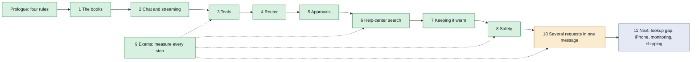
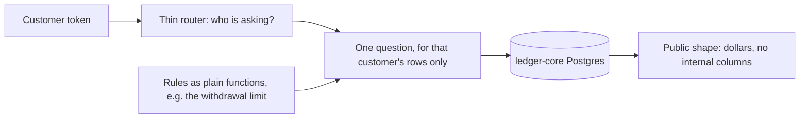
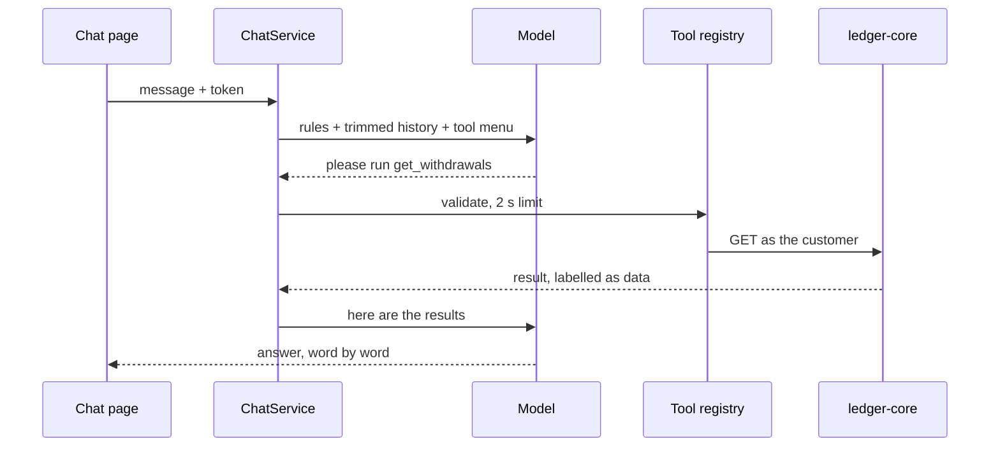
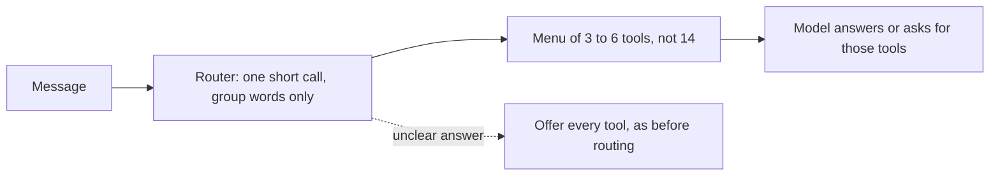
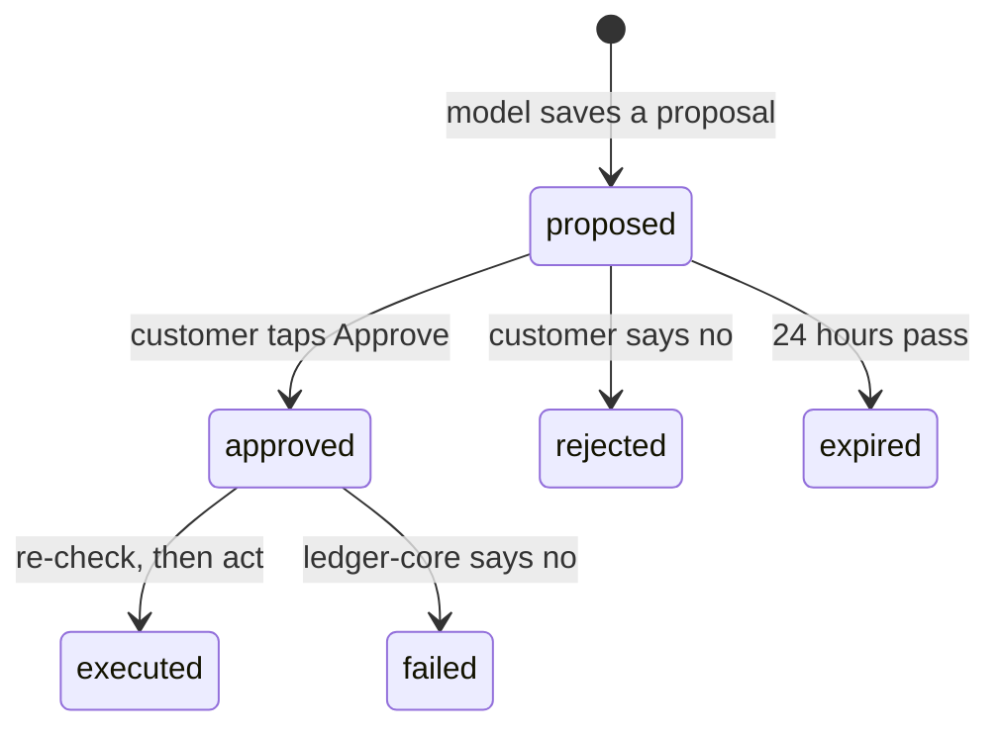
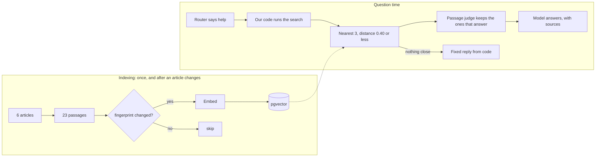
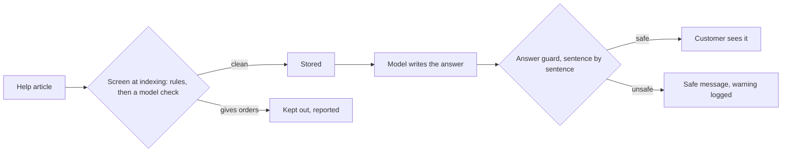
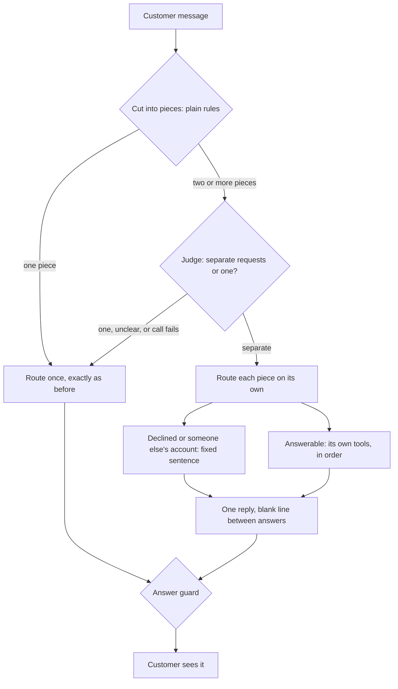

# Ask Ledger

A help assistant for a fictional investing app. A team of AI agents answers questions about the customer's own account, proposes fixes, and waits for the customer's approval before anything changes. The assistant answers from real account data and help-center articles, and it refuses stock picks, off-topic requests, and attempts to access other customers' accounts.

The AI runs on the company's servers. The iPhone app and the web page only send messages and display answers.

This is a learning and portfolio project, built phase by phase from a study plan. The sections below describe the target design; the [Status](#status) table says what is built today.

## What it does

- **Answers account questions.** The model calls tools on a fake brokerage backend (`ledger-core`) to look up balances, withdrawals, and transfers.
- **Answers help questions with citations.** Retrieval over help-center articles (RAG), with sources cited.
- **Proposes fixes and waits for approval.** Some tools can only *propose* a change (retry a transfer, update a legal name). Nothing runs until the customer approves, and every step is written to an audit log.
- **Works as a team of agents.** A supervisor plans; an account agent (read only) and a knowledge agent (cites sources) work at the same time; a resolution agent can only propose; a critic checks the answer before the customer sees it.
- **Refuses what it should.** Stock picks, off-topic requests, jailbreaks, multi-turn attacks, and requests for other accounts.
- **Is measurable.** Tracing, an evaluation gate, and fallbacks.

Example: *"My IRA transfer failed and I need cash by Friday."* The account agent and the help-center agent work in parallel. The answer says the $1,200 withdrawal arrives tomorrow and a fixed transfer takes 5 to 7 business days, so it won't land by Friday. A proposed fix (update the legal name, resend the transfer) waits for the customer to approve with Face ID, and every step shows in an Activity log.

## App screens

Mockups for the iPhone app (Phase 8). They show the behaviour the assistant is built to deliver. **None of the proposal, approval or agent screens is built yet.** The server side of approvals exists (proposals, approve and reject, the audit log, and an `approval_required` event in the chat stream), but there is no app screen for it yet (see [Status](#status)).

| Home | Chat with a proposed action | Developer mode |
|------|-----------------------------|----------------|
|  |  |  |

| Approval | Activity |
|----------|----------|
|  |  |

- **Home:** shows what is happening on the customer's account right now, an "action waiting for your approval" banner, and common questions. Built in steps 8.2 and 8.3, on top of the approval flow (5.4).
- **Chat:** shows "What I checked" (from the tool and source events), then a sourced answer, then a clearly labelled **proposed, not done yet** action with "Review and approve" and "Not now". Customers never see agent names.
- **Developer mode:** an internal trace for engineers and reviewers, off by default. It shows the supervisor's plan, the account and knowledge agents running in parallel, the resolution agent (propose only), and the critic's verdict, then the pause for approval. Built with the multi-agent phase (7B) and step 8.3. Customers never see this screen.
- **Approval:** lists each change in plain words. The customer's tap, confirmed with Face ID, is what runs it. The assistant cannot do it alone. Built in steps 5.4 and 8.3.
- **Activity:** the audit log of everything read, proposed, blocked or handed to a human, with who did it and when. Backed by the `audit_log` table and `GET /activity` (5.4).

## Architecture

Target design. Today the single agent loop in `assistant/services/agent.py` plays the role of the account agent, with read-only tools.

```
iPhone app (SwiftUI) ─┐
                      ├──> Chat API ──> Supervisor ─┬─> Account agent ────> ledger-core (read-only tools)
Web chat page ────────┘        │                    ├─> Knowledge agent ──> Help center search (RAG)
                               │                    └─> Resolution agent ─> proposed actions (propose only)
                               │                              │
                               │                           Critic ──> customer approves ──> ledger-core
                               └──> Safety layer, audit log, tracing, eval gate
```

## Build plan

About 190 hours over 17 weeks (roughly 11 hours per week). Work through the phases in order.

| # | Phase | What you build |
|---|-------|----------------|
| 1 | Setup | Project folder, tools, and a big-picture video on LLMs |
| 2 | Fake brokerage | `ledger-core`: customers, logins, accounts, withdrawals, transfers (no AI) |
| 3 | Chat pipe | Chat API and a web chat page that returns a canned reply |
| 4 | Real AI model | Open-source model on a Mac with Ollama, a system prompt and conversation memory |
| 5 | Account answers | 14 tools (read, help-center search and propose-only) plus an approval flow with an audit log |
| 6 | Help center (RAG) | Help articles plus search, with cited answers |
| 7 | Safety layer | Checks for jailbreaks, off-topic requests, and multi-turn attacks |
| 7B | Multi-agent orchestration | Supervisor and specialist agents in LangGraph, parallel work, a critic, a durable pause for approval, and a single-agent vs multi-agent comparison |
| 8 | iPhone app | SwiftUI app: chat, approval sheet, Activity screen and a hidden Developer mode |
| 11 | Monitoring | Tracing (one span per agent), an evaluation gate, and fallbacks |
| 12 | Package and ship | Docker Compose, CI, runbook, one cloud deployment, portfolio |

Optional stretch steps: vLLM, voice and image understanding.

The order is deliberate. The assistant needs account data before it can answer questions. The connection is built before the intelligence. Safety comes before more input types are added, and before the agent team, because every request, tool result and proposed action must pass the same guards. The iPhone app comes after the backend is stable.

## Status

| Phase | Status |
|-------|--------|
| 1. Setup | Done |
| 2. Fake brokerage (`ledger-core`) | Done |
| 3. Chat pipe | Done |
| 4. Real AI model | Done: tokenizer notebook, local model via Ollama, system prompt, token-budgeted chat history, Postgres |
| 5. Account answers | Done: all 14 tools (10 read-only, including a withdrawal-eligibility check whose rules live in ledger-core and the help-center search; three propose-only: retry a failed transfer, cancel a pending withdrawal, update the legal name; and a human hand-off that logs the request with a reference number), an agent loop, saved lookups for follow-up questions, tool-choice evals, and the approval flow behind it (proposals, approve and reject with 24 hour expiry and double-tap protection, an append-only audit log, and `GET /actions`, `POST /actions/{id}/approve`, `POST /actions/{id}/reject`, `GET /activity`) |
| 6. Help center (RAG) | Done, apart from hybrid ranking: six articles split by heading into passages, embedded with `nomic-embed-text` and stored in Postgres with pgvector; fingerprinted indexing that only re-embeds changed passages; a measured relevance cut-off; the search runs in code whenever the router says a message is a how-things-work question; retrieval and answer-quality evals; a `sources` event naming the article(s) a help answer came from; a passage judge (one short model call that keeps only the nearby passages that really answer the question); a keyword-search column and query (Postgres full-text) ready for hybrid ranking, not used yet |
| 7. Safety layer | Done: help passages are screened for planted instructions before they are stored; an answer guard checks every sentence before the customer sees it (links, requests for secrets, figures and codes nobody backs, turnaround times, personal tax claims); a decline route and a third-party route answer with a fixed sentence from code; a fixed reply when the help center has nothing; jailbreak, injection and screening exams |
| 7B. Multi-agent | In progress. A message with several requests is cut into parts, a model judges whether they are separate requests, and each is routed and answered in order (switch `SPLIT_MULTI_PART_MESSAGES`, off by default). Not started: the LangGraph wrap, the critic, a durable pause for approval. See [chapter 10](#chapter-10--two-requests-in-one-message) |
| 8, 11, 12 | Not started |

## The story of building Ask Ledger

Read it top to bottom: each chapter has one problem, one picture, and what the exams said.



Green is built, amber is in progress, blue is later.

### Prologue · The rules

| Rule | In practice |
|---|---|
| The model only asks | It can say "look up X". It cannot touch data or change anything. Our code acts. |
| Narrow first | Read-only lookups, English, text. No investment, tax or legal advice. |
| A person approves changes | The assistant proposes, the customer approves, every step is logged. |
| Measure, do not guess | A change counts only if an exam shows it helped. |

The model is local (Qwen2.5 7B on Ollama) behind an OpenAI-style API, so a hosted model is a settings change.

### Chapter 1 · The books

> An assistant needs real data, and rules no prompt can bend.



- `ledger-core` is a fake brokerage with no AI (port 8000): 5 demo customers, accounts, withdrawals, transfers, fees, tax forms.
- Every row leads to one customer. Anything not yours is a 404.
- Tests run on real Postgres built from the real migrations.

### Chapter 2 · A message in, words out

> The customer should see the reply as it is written.



- Events stream to the app: `token`, `tool`, `approval_required`, `sources`, `done`, `error`.
- Memory is Postgres history trimmed to 6,000 of the model's 32,768 tokens.

### Chapter 3 · Giving the model hands

> A model that answers from memory invents balances.

| Menu group | Tools |
|---|---|
| account | `get_accounts`, `get_withdrawals`, `get_transfers`, `get_transfer_status`, `check_withdrawal_eligibility`, `lookup_error_code`, `estimate_arrival` |
| reference | `get_fees`, `get_tax_documents`, `lookup_error_code`, `estimate_arrival` |
| change | `propose_retry_transfer`, `propose_withdrawal_cancellation`, `propose_legal_name_change` |
| help | `search_help_center` |
| human | `escalate_to_human` |

- **No tool takes a customer id.** The token decides whose data it is.
- Unknown arguments are rejected. Each call has a 2 second limit. Results are data, never instructions.
- The loop runs up to 3 rounds and 6 calls, then the model must answer. Date maths is code, never the model.

### Chapter 4 · Too many tools

> Every tool added to one big menu shifted the 7B model.



- The exam records `router_menu_ok`: did the menu contain what the answer needed? That separates router mistakes from model mistakes.
- Lesson: a prompt edit trades one case for another. A structural fix in code beats tuning words.

### Chapter 5 · Changes need a person

> A 7B model must never be the one that decides to change something.



- Approve is one atomic UPDATE, so a double tap or two phones cannot run it twice.
- The executor asks ledger-core again before acting, because approval may come hours later.
- Outcome and audit line are written in one transaction. `escalate_to_human` returns a reference number.
- The model cannot reach an executor. Only the customer's approval can.

### Chapter 6 · Answers from our own words

> "How do withdrawals work?" should come from the firm's articles, with sources.



| Step | Problem it fixed | Result |
|---|---|---|
| Measured cut-off 0.40 | A guessed 0.50 let 3 of 8 off-topic questions through | right passage first for 21 of 23 |
| Search run by code | The model skipped it and invented a source | tool exams: main 84.3 to 100, hard 92.9 to 100 |
| Passage judge | Look-alike questions got made-up answers | answer quality 88.2 to 100 |
| Fingerprints | Re-embedding every passage is slow | 0 of 23 re-embedded when nothing changed |
| Fixed reply when nothing found | The model invented a next step | nothing-found exam 70 to 100 |

### Chapter 7 · Waiting is a bug

> After a quiet spell Ollama unloads the model. The first question hit the 2 second tool limit.

| First word after a cold restart | Before | After |
|---|---|---|
| First customer | 9.1 s | 4.8 s |
| A second customer | 8.6 s | 3.3 s |

- Keep the models loaded (`OLLAMA_KEEP_ALIVE`, `MODEL_KEEP_ALIVE`), warm them in the background at start-up, and send a practice question through the router and judge.
- The customer's name moved to the last line of the system prompt, so every customer shares the prompt opening and the model reuses its work.
- The help search alone gets a 5 second limit.

### Chapter 8 · Text from outside the model

> A help passage is text someone else wrote. "Ignore your rules" inside it must not work.



| Test | Result |
|---|---|
| Poisoned passage, no defence | The model obeyed 3 of 7 planted orders |
| Same, with a "quoted text" note | Still 3 of 7, but different ones |
| Screen at indexing | 22 of 22 planted passages stopped, 0 of 25 real ones |
| With the answer guard | Obeyed 0 of 21 and 0 of 27 on two more sets; 0 of 34 real answers wrongly stopped |
| Jailbreak and topic, with the decline route | 12 of 17 held at first, then 51 of 51; held-out 36 of 36 |

- The guard stops links, requests for secrets, figures and codes nobody backs, unbacked turnaround times and personal tax claims.
- Investment advice, tax advice and off-topic requests get a fixed sentence from code. Someone else's account takes its own `thirdparty` route.
- A meaning-based tax check was tried and parked: 7 of 8 advice questions caught, but 1 of 12 real lookups wrongly declined.
- Gaps: small plain numbers and spelled-out numbers are not checked.

### Chapter 9 · The exams that kept it honest

| Exam | What it checks | Latest |
|---|---|---|
| Tool choice | Which tool, which arguments | main 96.2, multi-turn held-out 100 |
| Outcomes | The final answer against the demo ledger | 100 |
| Retrieval | Right passage first; judge turns away unknowns | 44 of 50 real kept, 26 of 30 unknowns out |
| Answer quality | Facts stated, no invented numbers or articles | 100 |
| Injection (3 sets) | Planted orders not obeyed | 0 obeyed of 69 |
| Screening | Planted passages stopped | 22 of 22, 0 of 25 real |
| Figure guard | Invented figures stopped | 16 of 16 |
| Jailbreak and topic | Refuse what must be refused | 51 of 51; must-not-decline 24 of 24 |
| Multi-step routes | Every needed area routed | 19 of 22, held-out 7 of 10 |
| Message splitting | One request stays whole, several are cut | 5 of 303 cut wrongly, 3 of 35 left whole |

Rules the exams taught: read which cases moved, not only the total; never write a score in a PR before measuring it; keep held-out sets for checking, not tuning; measure the thing that matters, not a stand-in for it.

### Chapter 10 · Two requests in one message

> "What is my balance, and how long do bank transfers take?" Routed as one, a declined half can swallow the real half.



Switch: `SPLIT_MULTI_PART_MESSAGES`, off by default. Off means the whole message is routed as one request.

| Piece | File | Job |
|---|---|---|
| Cut | `message_parts.py` | Plain rules, no model. Jailbreak openers stay with their request |
| Judge | `parts_judge.py` | One word back: SEPARATE or ONE. Unclear means one |
| Route | `routed_parts.py` | Each piece routed on its own |
| Answer | `answer_parts.py` | In order; later pieces see earlier answers; the guard restarts its turnaround check per piece |

| Measure | Result |
|---|---|
| Multi-step routes | 15 of 22 and 4 of 10 whole, 19 of 22 and 7 of 10 cut and judged |
| One-request messages cut wrongly | 31 of 303 to 5 of 303 |
| Attacks (jailbreak, injection, 10 mixed) | the same with splitting on and off |
| First word, one request | unchanged, about 1.0 s |
| First word, two requests | about 0.15 to 0.6 s more |

**What went wrong.** The first way to decide "separate or one" compared the routes the router gave each piece. It looked fine on the route exam and merged real requests in the live app. A model judge replaced it:

| Who decides if the pieces are separate | Right, of 40 |
|---|---|
| Compare the routes | 24 |
| Ask a model | 35 |

Routing each piece with the earlier pieces' text was measured and rejected: 26 of 30 cases covered alone, 24 with context, and a tax-advice piece stopped being declined.

### Chapter 11 · What is left

| Next | What | Why |
|---|---|---|
| Account-lookup gap | An account question that also gets help and reference routes is answered from the help search, with no account lookup | It affects ordinary single questions too |
| Splitting in dev | Try real two-request questions, then decide the default | The exams cannot show how it feels |
| LangGraph | Decide whether a graph adds anything | It helps with retries, pauses and tracing, not with splitting |
| iPhone app (8) | Chat, approval sheet with Face ID, Activity screen | After the backend is stable |
| Monitoring (11), shipping (12) | Traces, CI that runs the exams, deployment, a real support queue | Today the exams run by hand |

Same shape as production agents: a request, an orchestrator looping between a model and tools, a person approving changes, guards around it. The differences are chosen: a small local model, a hand-written loop, exams run by hand.

## Repository layout

```
ledger_core/        Fake brokerage API (port 8000): routers/, models, auth, seed.py, migrations/
assistant/          Chat API (port 8001), layered:
  routers/            HTTP only: parse the request, call a service, return the response
  services/           Chat logic, the agent loop (agent.py) and token-budgeted history (no HTTP, no SQL), plus:
                      tool_router.py (the router and the code rules after it), answer_guard.py (checks each sentence),
                      passage_judge.py and passage screening (help text), model_readiness.py (start-up warm-up), and the
                      multi-request path: message_parts.py (cut), parts_judge.py (separate or one), routed_parts.py (route
                      each piece), answer_parts.py (answer in order)
  repositories/       The only place that runs database queries
  clients/            Calls to ledger-core (with the caller's own token) and to the embedding model
  tools/              What the model may ask for: one module per purpose (accounts, withdrawals, transfers, fees, tax_documents,
                      error_codes, arrival_estimates), each with its arguments, code and menu entry; __init__.py lists them all;
                      registry.py validates and runs them
  knowledge/          Facts kept in code (the transfer error-code catalog, business-day date math) and the help-center articles
                      (help_center/*.md) with the code that splits them into passages by heading
  migrations/         Alembic migrations for the assistant's database
  prompts/            The system prompt and the router prompt
evals/              Exams (JSONL cases) and their runners: tool choice, help-center retrieval, answer quality; reports are gitignored
web/                Gradio chat page (port 7860)
notebooks/          Learning notebooks (01_tokens.ipynb)
tests/              pytest suite (runs against real Postgres test databases)
docker-compose.yml  Local Postgres 17 with the pgvector extension: one server, one database and login per service
```

Each service owns its own database and login (`ledger_core`, `assistant`). The assistant never reads ledger-core's database; it calls ledger-core's API.

## How an account question is answered

The model never touches the data. It can only *ask* for a lookup; our code runs it.

1. The router identifies the customer from their token and hands over to `ChatService`.
2. `ChatService` saves the message and builds the prompt: the system rules plus recent history, trimmed to a token budget. Lookups from the last two assistant replies are replayed, labelled as snapshots that may be out of date.
3. A short routing question to the same model (`assistant/services/tool_router.py`) picks which kinds of help the message needs (`account`, `reference`, `help`, `change`, `human` or `none`), using the last few messages so short follow-ups such as "cancel it" make sense. The model is then offered only those tools (3 to 6 instead of all of them), and only those can run. If routing fails, every tool is offered.
4. If the route is `help` (a question about how things work, such as "what is a Roth IRA?"), our code runs the help-center search itself before the model speaks, so a small model cannot skip it and invent an answer. The question is embedded, the closest passages are found in Postgres (pgvector), anything farther than the cut-off is dropped, a short model call (the passage judge, `assistant/services/passage_judge.py`) keeps only the passages that directly answer the question, and the rest reach the model as a labelled tool result. If the judge fails or replies with nonsense, every nearby passage is kept, so a broken judge never breaks an answer. If nothing is close enough, the model is told to say it does not have that information.
5. The agent loop (`assistant/services/agent.py`) asks the model, offering that menu. If the model asks for tools, the registry validates the arguments, runs the calls in parallel with a 2 second limit, and returns the results labelled as data. This repeats for up to 3 rounds and 6 calls, then the model must answer.
6. The answer streams to the client as server-sent events (`token`, `tool`, `approval_required`, `sources`, `done`, `error`) and is saved with its lookups. `sources` carries the names of the help-center articles the search returned (each once), and is sent only when a search found something, so the app can show "Source: ..." under the answer. In the code, `ChatService.stream_reply` only orchestrates: the tools drop what needs announcing into a `PendingAnnouncements` object (proposals, article names), and `_announcements_after_round` turns it into events after each round.

Safety by design: no tool takes a customer id (the caller's token decides whose data it is), unknown arguments are rejected, and text inside results is never treated as instructions. Most tools only read. The three propose tools can only save a proposal; nothing changes until the customer approves it with their own request (`POST /actions/{id}/approve`).

Tools: `get_accounts`, `get_withdrawals`, `get_transfers`, `get_transfer_status`, `get_fees` and `get_tax_documents` (these six call ledger-core), `lookup_error_code` and `estimate_arrival` (pure code, so the model never does date arithmetic), `check_withdrawal_eligibility`, `escalate_to_human` and `search_help_center` (the last one is run by our code on the `help` route). To add a tool, write its module in `assistant/tools/` and add it to `ALL_TOOLS` in `assistant/tools/__init__.py`.

## Evals

`evals/` measures which tools the model chooses and with what arguments. It asks the real model each question and scores the tool requests; no tools are run.

```bash
uv run python -m evals.run_tool_eval                                        # main set
uv run python -m evals.run_tool_eval --dataset evals/tools_hard.jsonl --runs 2
uv run python -m evals.run_tool_eval --dataset evals/tools_multiturn.jsonl  # follow-up questions with history
uv run python -m evals.run_tool_eval --dataset evals/tools_propose.jsonl     # propose-only tools (approval flow)
uv run python -m evals.run_tool_eval --no-router                           # offer every tool, as before routing existed
```

- `--runs N` asks each question N times; a question that passes only some of the time is labelled FLAKY. `--min-score` sets the pass mark (exit code 1 below it, for CI).
- A case has one main answer (`expected_tools`) and may list `alternatives`: other answers that are just as correct (for example looking up an error code directly instead of the whole transfer). The model passes if it matches any of them.
- Evals route the way the app does. Each result records which tools were on offer, and `router_menu_ok` is how often the menu still contained what the case needed, which separates a routing mistake from a model mistake.
- Reports are written to `evals/results/latest.json`, including what the model said, so failures can be diagnosed.
- Tune on the main, hard and multi-turn sets. The `*_holdout.jsonl` sets are for checking a fix on wording it was never tuned on, so run them sparingly.
- `LLM_TEMPERATURE=0` keeps tool choice steady and the scores meaningful.
- On the `help` route the search is run by code, so the eval counts it as called and does not ask the model.

Two more exams cover the help center (both need Ollama running and the help center indexed):

```bash
uv run python -m evals.run_retrieval_eval        # does the right passage come first? sweeps cut-offs (MAX_DISTANCE = 0.40 was chosen from this), then measures the passage judge and times it
uv run python -m evals.run_answer_eval           # does the written answer stay inside the passages?
```

The safety and multi-request exams (the story's chapters 8 and 10 explain them):

```bash
uv run python -m evals.run_jailbreak_eval            # refuses what it must; add --with-answer-guard to pass answers through the guard
uv run python -m evals.run_injection_eval            # a poisoned passage is not obeyed (exit code 1 if any order is obeyed)
uv run python -m evals.run_multistep_eval --runs 3 --by-parts    # does every area a multi-request message needs get routed?
uv run python -m evals.run_split_eval                # no model: one-request messages stay whole, several-request messages are cut
uv run python -m evals.run_split_gate --runs 3       # jailbreak and injection exams through the parts path, splitting off and on
```

Two more tools for looking at the whole flow: `uv run python -m evals.trace_question "<question>"` shows the route, each round of tool calls and the final answer for one question; `evals/run_outcome_eval.py` checks the final answer against the demo ledger's real numbers. The sealed set `evals/tools_sealed.jsonl` is written and owned by the project's learner: do not tune prompts against it. `evals/WRITING_EVALS.md` explains how to write cases.

The answer-quality exam asks the real flow (router, search, model) and checks with plain code: the expected facts are stated, every number in the answer appears in the question or a returned passage, only returned articles are named, a case may name the articles that must come back as sources (`must_cite`) or say nothing should (`must_cite_nothing`), and questions the help center does not cover get an honest "I don't have that information". It writes `evals/results/answers_latest.json`. Without the passage judge, questions that sound like the firm but are not covered (options trading, for example) sat inside the cut-off and got made-up answers (score 88.2); with it the score is 100. The retrieval exam still shows the judge is imperfect (it turned away 26 of 30 unknown-question attempts and dropped 4 of 48 real ones), so it is measured, not assumed. Only questions that reach the help search belong in this exam; questions about the customer's own fees or balances are tool-choice cases.

## Running locally

Requirements: [uv](https://docs.astral.sh/uv/), Docker, and [Ollama](https://ollama.com) with `ollama pull qwen2.5:7b-instruct` (the chat model) and `ollama pull nomic-embed-text` (turns text into numbers for help-center search).

```bash
# 1. Configure: copy the example, then fill in real values (generate passwords with: openssl rand -hex 16)
cp .env.example .env

# 2. Install dependencies (uses uv.lock and the Python version in .python-version)
uv sync

# 3. Start Postgres with pgvector (creates both databases and logins on first start)
docker compose up -d

# 4. Create the tables with migrations, then load the demo customers (password for all: demo1234)
uv run alembic -c ledger_core/alembic.ini upgrade head
uv run alembic -c assistant/alembic.ini upgrade head
uv run python -m ledger_core.seed
uv run python -m assistant.index_help_center      # embed the help-center articles (safe to re-run; only changed passages are re-embedded)

# 5. Run the services (one terminal each)
uv run uvicorn ledger_core.main:app --port 8000 --reload
uv run uvicorn assistant.main:app --port 8001 --reload
uv run python web/app.py            # chat page at http://localhost:7860
```

### Keeping the models loaded (Ollama)

Ollama unloads an idle model after 5 minutes, and loading the chat model takes about 8 seconds, longer than the 2-second limit each tool gets. Two settings keep the first question after a quiet spell from failing:

- `MODEL_KEEP_ALIVE` (default `1h`, in `.env`): at start-up the assistant loads the chat and embedding models in the background and asks Ollama to keep them for this long. If Ollama is down it only logs a warning. This applies to that one request.

- `SPLIT_MULTI_PART_MESSAGES` (default `false`, in `.env`): when `true`, a message with several requests is cut into parts and each part is routed and answered in order. Off by default until the splitting exams pass; with it off the whole message is routed as one request.

- `OLLAMA_KEEP_ALIVE` on the Ollama server itself: every later request resets the timer to the server's own default, so set it to the same value. It applies to every model on that Ollama, then restart Ollama. For the menu-bar app: `launchctl setenv OLLAMA_KEEP_ALIVE 1h`, then quit and reopen Ollama. For a terminal: `OLLAMA_KEEP_ALIVE=1h ollama serve`. Use `30m` if memory is tight (the two models take about 7 GB).

- Practice question (`assistant/services/model_readiness.py`): even after a model is loaded, its first real use of the router and judge prompts is slow once (about 4 and 2 seconds). Start-up sends a practice question through both, then writes one practice answer through the chat prompt. Measured with the real app: the router and the help search then take 0.2 and 0.9 seconds on the first question instead of 4.1 and 2.5.
- The help search tool alone gets a 5-second limit (`timeout_seconds` on the tool); every other tool keeps 2 seconds.

The first answer after a restart used to take 9 seconds to its first word. Ollama has to read the 1,290-token chat prompt, and it can reuse its work only for the part of a prompt that matches an earlier one. The customer's name used to be on line 1, so no two customers shared a start and every new name cost 5 to 6 seconds. Now the name is the last line of `assistant/prompts/system.md`, so all customers share the rest, and start-up writes one practice answer to read it ahead of time. Measured (first word, models unloaded and the assistant restarted): first customer 9.1s -> 4.8s; a second customer asking something else 8.6s -> 3.3s. `evals/time_first_word.py` measures the first word through the real `/chat` endpoint (`ASK_AS=<email>` asks as another customer) and `evals/prompt_cost.py` shows Ollama's own count and time for reading the prompt (use a name nobody has used since the last restart, or the cache hides the cost). Keep the customer's name at the end of the system prompt: any text that differs per customer near the start brings the 5-second cost back.

Production differs: a hosted model or an always-on inference server never unloads, so there is nothing to keep alive. The warm-up uses Ollama-only endpoints, so drop it when switching providers.

Run the tests with `uv run pytest` (376 tests). They use the `ledger_core_test` and `assistant_test` databases, so demo data is never touched.

Changing a table: edit the model, run `uv run alembic -c <service>/alembic.ini revision --autogenerate -m "what changed"`, review the generated file, then `upgrade head`.

## License

See [LICENSE](LICENSE).
